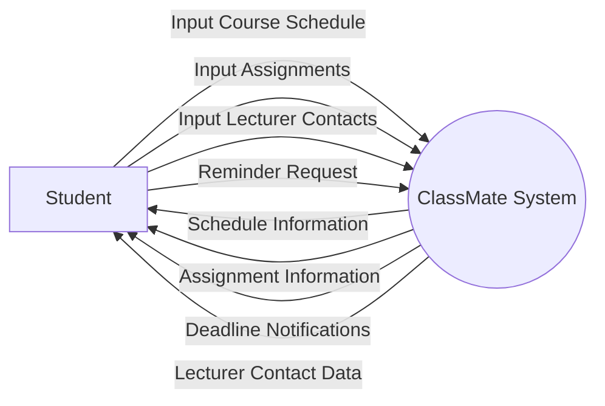
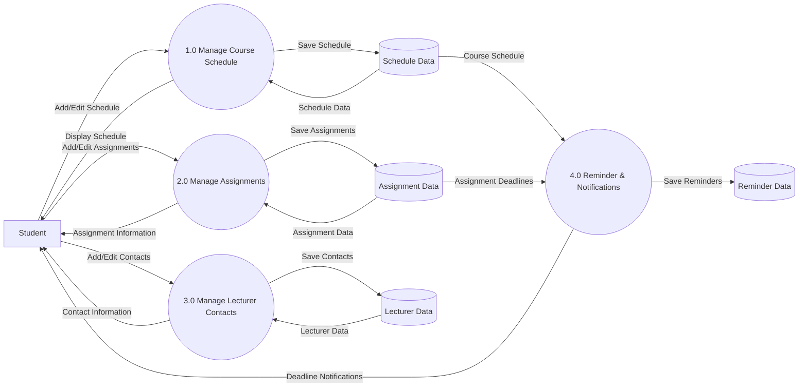

# Data Flow Diagram (DFD) – ClassMate Application

## 1. Context Diagram

---

# 2. DFD Level 1

---

# DFD Explanation

## External Entity

### Student
The main user of the application who inputs and receives information from the system.

---

## Processes

### 1.0 Manage Course Schedule
Handles course schedule data:
- Add schedule
- Edit schedule
- Delete schedule
- View schedule

### 2.0 Manage Assignments
Handles assignment data:
- Add assignments
- Edit assignments
- Mark assignments as completed
- Delete assignments

### 3.0 Manage Lecturer Contacts
Handles lecturer information:
- Save contacts
- Edit contacts
- Delete contacts

### 4.0 Reminder & Notifications
Sends reminders for:
- Assignment deadlines
- Class schedules
- Important notifications

---

## Data Stores

### Schedule Data
Stores all student course schedules.

### Assignment Data
Stores all assignment data and deadlines.

### Lecturer Data
Stores lecturer contact information.

### Reminder Data
Stores reminder and notification data.